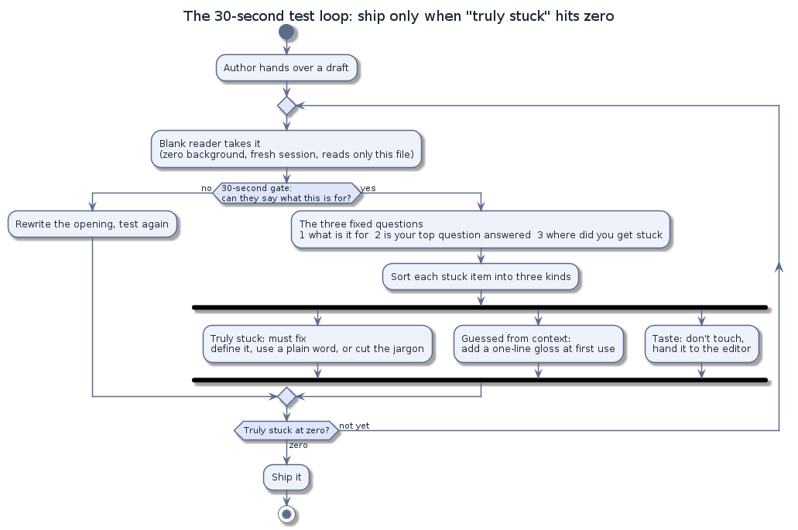

# The Blank-Reader 30-Second Test

English · [简体中文](README.md)

A protocol for finding out whether a document explains itself — before your readers tell you it doesn't.

This figure answers one question: which gates a draft passes between hand-over and ship (reader takes it → 30-second gate → three fixed questions → sort and fix → re-test → ship). (Diagram source: `assets/src/loop.en.puml`)

## The problem

People who wrote a document are the worst judges of whether it reads well. They already know what it means, so they can't see the walls (the gaps a new reader falls into): three jargon terms in the first sentence, a term defined on page 4 but used bare on page 1, a number that contradicts another number two paragraphs later. Expert reviewers have the same blind spot — they already know the right path through the material, so they never stumble onto the broken side road.

## The idea

Hand the document to a smart adult with zero background in the subject — the **blank reader** — and ask one question: **after 30 seconds, can they say what this thing is for?** Then let them read on and report every place they got stuck. Every confusion is a bug to investigate in the document, not a fault in the reader (and investigating is not automatically changing — see the caveat in the last section).

The 30-second gate and the pass bar are two different gates: the gate checks the opening, the bar checks the retelling after a full read. The pass bar is not "they could paraphrase it." It is: **they can retell it to a friend with zero factual drift.** Before the round, the author (or whoever runs the test) marks 1–2 must-get-right points — the sentences you'd blush about if a friend retold them wrong, such as a key causal claim, an ordering, or a definition. If the reader gets any of those wrong, the document goes back for a rewrite and another round (one full pass of this test: reader, questions, fixes, re-test). The retelling is judged by the person running the test, who checks it against the original sentence by sentence — the reader's own confidence is not the evidence.

Don't cut the 30 seconds — 15 seconds measures skimming, not understanding. If you want a stricter test, raise the accuracy bar, not the speed.

The person running the test holds the stopwatch, starting when the material reaches the reader; the 30 seconds are a rule of thumb, not a lab measurement.

## What you need

- **One document.** One at a time — a green README (one that passes the project's automated checks: the code builds, the links on the page work, whatever the project requires before shipping) says nothing about the project's other pages. Keep a list of which public files have and haven't been through a round. A single document too long to read in one sitting (say, a forty-page manual) gets split by chapter first; the 30-second gate then applies to the opening of each piece.
- **One blank reader.** A person, or an AI assistant in a fresh session with no memory of the project. Blankness is guaranteed by protocol, not by who you pick:
  - a fresh session every round (never resume a previous one — that brings the last round's reading and conclusions back with it, and "nothing stuck this time" becomes memory, not improvement);
  - a clear framing: "you are a first-time reader with zero background in this field";
  - hard prohibitions: read only the material given; do not look up how the thing is "supposed" to work; do not search your own history.
- **The standard prompt** — the exact words you hand to the blank reader (human or AI), asking it to retell the material in its own words; that retelling is what you grade in question 1:

  > explain this to a smart adult with zero background in this field — clearly enough that they could accurately retell it to a friend afterward. sacrifice no fact that matters: {the document}

## The three fixed questions

The 30-second question is the gate; once a reader is past it, the rest of the round runs on three fixed questions. Keep them identical across rounds so rounds are comparable:

1. **What is this for?** — the same question as the 30-second gate, now answered in detail and in your own words. Quoting the document's own terms back counts as *not* understanding (this is the protocol's one built-in fake-success trap).
2. **What is the one thing you most want to know — and does the document answer it?**
3. **Where did you get stuck?** List every word or passage, and mark each as "truly stuck," "guessed from context," or "just curious why" (a taste question, not a comprehension block).

Also have the reader log how many seconds they actually read and which paragraph they stopped at.

Then run the highest-yield follow-up: **ask the reader to advise the writer.** Have them go through their stuck list and propose a fix for each item. The value is that they name structural problems ("jargon never gets a one-line explanation at first use"), not "write more clearly."

## Classify the stuck list — three kinds, three actions

- **Truly stuck** (re-reading the passage cannot resolve it from inside the document): must fix — add a definition, swap in a common word, or cut the jargon.
- **Guessed from context**: add a one-line parenthetical at first use. Cheapest fix, highest yield — in practice most stuck words are cured by a one-line gloss where the word first appears.
- **Taste** — the "just curious why" items from question 3 ("why is it called that?"): don't touch. Naming taste is the editor's call, not a comprehension bug — record it and move on.

Three special classes that are not vocabulary problems:

- **Numbers that contradict each other.** "It says 23 items throughout, then treats 24 as the total on the last line" is a consistency bug, worse for credibility than jargon. Fix by stating the relationship between the two numbers where they appear — don't make the reader flip pages to reconcile them.
- **Self-referential chains**: a term defined using another term that is never defined. Parse every definition; if it leans on an undefined word, that one is "truly stuck."
- **Hard factual errors** (wrong dates, wrong history): have the reader check every number and factual claim against the source material you supply with the test (the data files, the linked references), and list each contradiction with its location (line or paragraph). For this step the reader stops being the sealed blank reader and acts as a checker with the sources you hand over. This checks the document against its sources — not whether the underlying thing itself works. Anything the reader cannot reach must be reported as "unverifiable," never as "verified." This is often the blank reader's sharpest contribution — the writer can't see it, because the wrong fact is what's in their head.

## Iterate, then stop

- Explanations must appear at first use, not at the end — a glossary at the bottom of the page is a glossary nobody reads. If a good explanation already exists later in the text, move it to first use.
- Re-test after fixing, with a **fresh session and a renamed copy** of the material — renamed so the new reader can't recognize it as a file it has seen a version of before — and re-copy the material from the latest version before every round: testing a stale snapshot stamps approval on a draft nobody will ship.
- Each new round must specifically re-test the previous round's fixes: a patched definition can introduce new undefined terms, and a retitled heading can re-contradict the body.
- Stop when "truly stuck" hits zero. Jargon-dense pages typically converge in 3–5 rounds. Track the counts per round (truly stuck N→M, guessed N→M) and hand the before/after to the decision-maker (whoever has the final say on shipping this document — usually the author or an editor); don't keep reworking the taste layer as if it were a comprehension bug.

## What this test is not

- It answers "can a first-time reader understand this?" — not "is it correct?", "is it fast?", or "is it beautiful?" Correctness audits, performance, and taste are separate gates.
- The reader's report is **evidence, not verdict** — input for you to check, not a final ruling. "I got stuck" does not automatically mean change the document — verify the claim against the source first; a report about what the text "says" can be a misreading.
- A passing document is not necessarily a good document. It is a document that doesn't lose its readers in the first 30 seconds.

## Origin

Distilled from practice on the [AMBER](https://github.com/getaskclaw/amber) benchmark project (a public project that scores AI models on a fixed set of tasks), where this protocol is the ship gate: no public page goes out before a blank reader passes it. Named for the trigger word our team uses: `[BLANK-READER]`.

## License

MIT — see [LICENSE](LICENSE).
