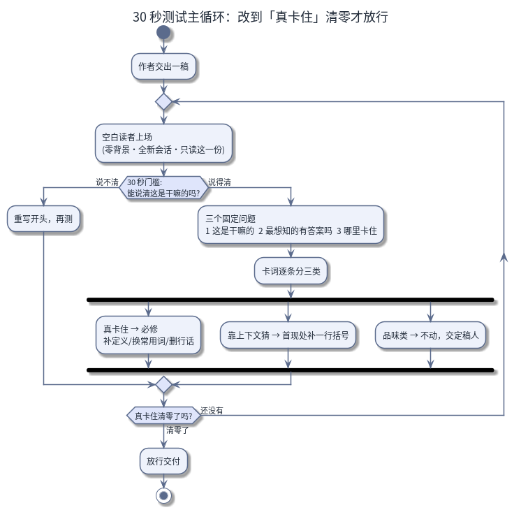

# BLANK-READER 30 秒测试

[English](README.en.md) · 简体中文

一套固定的操作流程（下称「协议」）：在你的读者告诉你「看不懂」之前，先测出这份文档到底能不能自己把自己讲清楚。

这张图回答一个问题：一稿从交出到放行，中间经过哪几关（读者上场 → 30 秒门槛 → 三个固定问题 → 卡词分三类 → 复测 → 放行（=批准发布）。（图源：`assets/src/loop.zh.puml`）

## 要解决的问题

写文档的人，最不适合判断这份文档好不好读。他们已经知道它在讲什么，所以看不见那堵墙：第一句就压了三个行话（圈内术语）、一个词在第 4 页才给定义却在第 1 页就裸用（不加任何解释就直接用）、一个数字和两段之后的另一个数字互相打架。专家评审有同样的盲区——他们已经知道正确的走法，所以永远踩不到那些会让新读者理解走偏的句子。

## 做法

把文档交给一个**零背景的聪明成年人**（即「空白读者」），只问一个问题：**30 秒之后，他能不能说清这东西是干嘛的？**然后让他继续读，把每一处卡住的地方报出来。每一处困惑都是要去文档里查的 bug 嫌疑，不是读者的毛病（查不等于必改，见「这个测试不管什么」一节）。

通过线和 30 秒门槛是两道关：门槛只管开头那一刻，通过线管读完全篇之后的转述。通过线（=合格标准）不是「他能复述一遍」，而是：**他能把内容转述给朋友，且零事实走样（一个要紧的事实都不许说错）。**每轮开始前，由作者（或组织测试的人）标出 1 到 2 个必对点（=这轮验收时读者必须说对的地方，比如一个关键因果、一个排序、一个定义）；读者说错任一，文档打回重写，再测一轮。转述由组织测试的人拿着原文逐句核对来判——读者自己觉得说对了，不算数。

计时由组织测试的人掐，从材料交到读者手里那一刻起；30 秒是大致的门槛，不必精确到秒。

别砍那 30 秒——15 秒测的是扫读（快速扫一眼），不是读懂。想加严，就抬高准确度的线，不要动速度。

## 你需要什么

- **一份文档。**一次只测一份——README 过了，不代表细节页也过了。留一张清单，记下哪些对外文件过了、哪些还没过。单篇太长读不完的（比如几十页的手册）先按章节拆小再测，30 秒门槛只作用于每个小件的开头。
- **一个空白读者。**可以是真人，也可以是一个**全新会话、对本项目零记忆**的 AI 助手。空白度靠协议保证，不靠你选谁：
  - 每轮都开新会话（永远不要续上一轮的会话——那会把上一轮的读物和结论一起带回来，「这次没卡住」就成了记忆而不是效果）；
  - 一句明确的定位：「你是第一次接触这个领域的读者，零背景」；
  - 硬性禁令：只许读给定的材料；不许去查这东西「应该怎么工作」；不许翻自己的历史。
- **标准提示词**——交给空白读者（真人或 AI）的原话，让它用自己的话复述材料，这份复述就是第一问的判卷依据：

  > explain this to a smart adult with zero background in this field — clearly enough that they could accurately retell it to a friend afterward. sacrifice no fact that matters: {文档正文}

  这句话的意思：把材料讲给一个零背景的聪明成年人听，讲到他能不走样地转述给朋友，一个要紧的事实都不许丢。{文档正文} 处填入要测的材料。

## 三个固定问题

30 秒那一问是门槛；读者过了这一关，余下的一轮就用这三个固定问题。跨轮用同一套问题，轮次之间才可比：

1. **这东西是干嘛的？**——和 30 秒门槛是同一问，只是这次要答得更细，且用你自己的话，不许抄原文术语（抄 = 没懂；这是本协议唯一内置的假成功陷阱，即「看着像看懂、其实没懂」的交卷方式）。
2. **你最想知道的一件事是什么？材料里找得到答案吗？**
3. **哪里看不懂？**逐条列出每个词、每段话，并自标「真卡住」「靠上下文猜的」，还是「只是好奇为什么」（品味类，不是理解障碍）。

同时让读者记下：他实际读了多少秒、读到第几段停下的。

然后是最高产的一轮追问：**让读者给写材料的人提建议。**让他逐条对应刚才卡住的地方出改法。价值在于他点出的是结构问题（「行话第一次出现时从不带一句解释」），而不是「再写清楚点」这类废话。

## 卡词（=让读者卡住的词）分三类，三类各有动作

- **真卡住**（重读那段话也无法从材料内部解决）：必须修——补定义、换常用词、或删掉行话。
- **靠上下文猜的**：在首次出现处补一个一行为限的括号。成本最低、收益最高——实测下来，大多数卡词都能被首现处的一句括号救回来。
- **品味类**（=第三问里的「只是好奇为什么」，比如「为什么叫这个名字？」）：不动。命名品味是定稿人（=最终拍板这份文档能不能发出去的人，通常是作者或编辑）的事，不是理解 bug——记下来，交给定稿人，然后放过它。

除了词汇问题，还有三类特殊情况：

- **数字互相打架。**「通篇说共 23 条，最后一行却拿 24 当总数」是一致性 bug，比行话更伤可信度。修法：在两个数字出现的地方，用一句话说清它们的关系——别让读者自己翻页去拼答案。
- **自指链**：用没定义的词去解释没定义的词。逐条解析每个定义；凡定义里倚赖一个未定义的词，那条就是「真卡住」。
- **硬事实错**（日期错、历史错）：让读者把每个数字、每条事实断言，逐条对着你随测试一起提供的源材料（数据文件、参考链接）核一遍，逐条列出矛盾，并带上位置（行号或段落）。读者够不到的东西，必须报「无法核实」，永远不许报「核对无误」。这一步读者不再是「只读一份」的空白读者，而是拿着你给的源材料当核对员。这核的是文档和源材料对不对得上，不是事物本身灵不灵。这往往是空白读者最锋利的贡献——写手自己看不见，因为他脑子里装着的就是那个错的事实。

## 迭代，然后停手

- 解释必须出现在首次使用处，不能放在文末——页尾的生词表是没人读的生词表。如果后文已有一句好解释，把它搬到首现处。
- 修完再测，必须用**新会话 + 改了名的材料副本**（改名是为了让新读者认不出这是它见过的那份文件的某个版本）；且每轮开跑前从最新版本重拷材料——拿上一版的旧文件测试，等于给一份没人会发出的草稿盖章。
- 每一轮都要专门复测上一轮的修复本身：补上去的定义可能引入新的未定义词，改过的标题可能重新和正文矛盾。
- 「真卡住」清零就停手。行话密度高的页面一般 3 到 5 轮就改到不再冒出新问题。逐轮记下条数（真卡住 N→M、靠猜 N→M），把前后对照交给定稿人收尾；别把品味层当理解 bug 反复返工。

## 这个测试不管什么

- 它只回答「第一次读的人能不能看懂」——不回答「对不对」「快不快」「美不美」。事实核验、性能、品味是另外三道门。
- 读者的报告是**材料，不是判决**（=待核实的证据，不是最终判决）。「我卡住了」不自动等于要改文档——先回源头核一遍那句话；读者报告里「文中写着 X」可能是误读。
- 通过的文档不一定是好文档。它只是不会在头 30 秒就把读者弄丢。

## 出处

提炼自 [AMBER](https://github.com/getaskclaw/amber) 基准项目（一个公开的 AI 模型基准测试项目）的实践：AMBER 给 AI 模型出一套固定的题并打分，而本流程在那里是每一页对外文档的放行闸——任何公开页面都要先过一个空白读者，才允许发出。名字来自我们团队用的触发词：「[BLANK-READER]」。

## 许可证

MIT——见 [LICENSE](LICENSE)。
